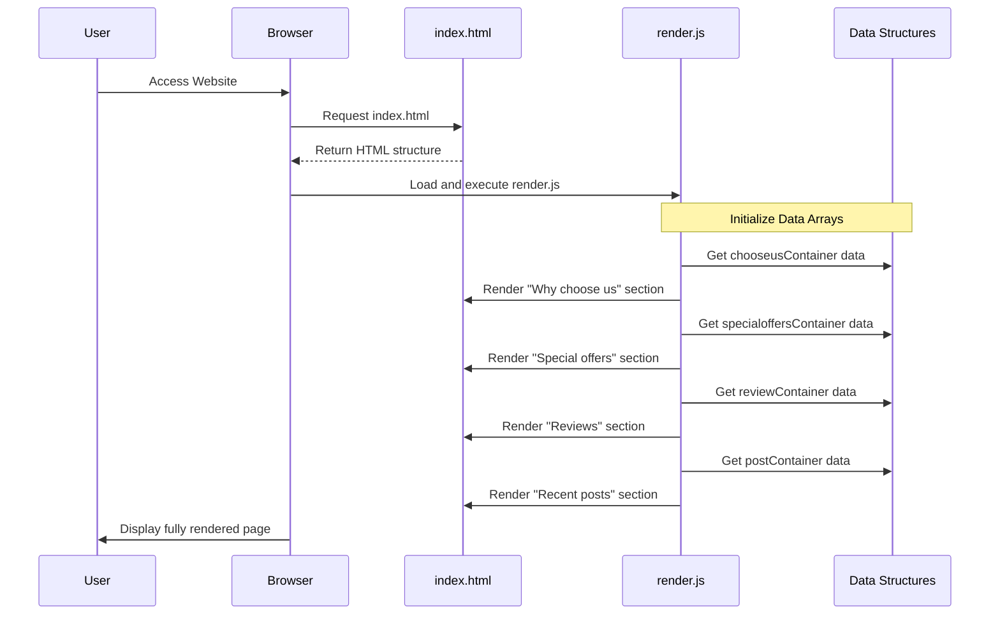
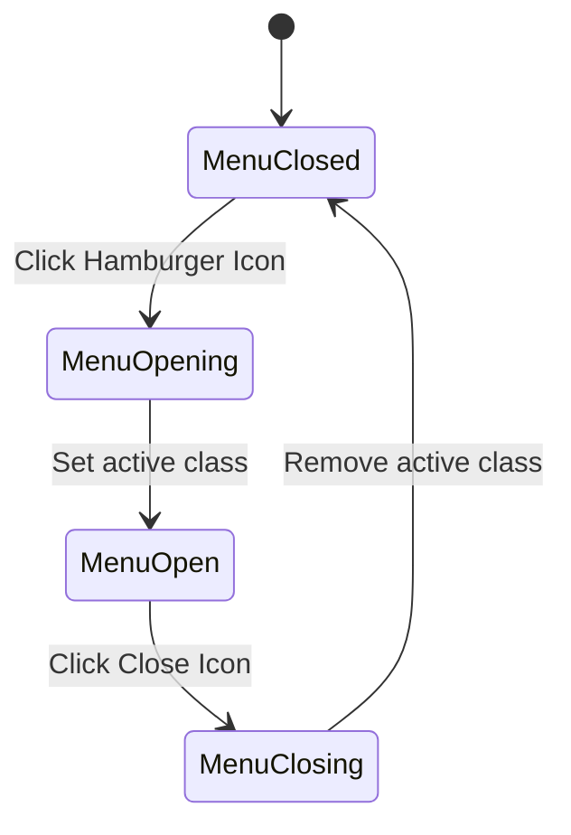

# Behavioral Diagrams

This document contains behavioral diagrams representing the flow of the system's main features.

## Sequence Diagram: Page Load and Content Rendering

The following sequence diagram shows how the system loads and dynamically renders content when a user visits the website.

## Activity Diagram: Mobile Menu Interaction

