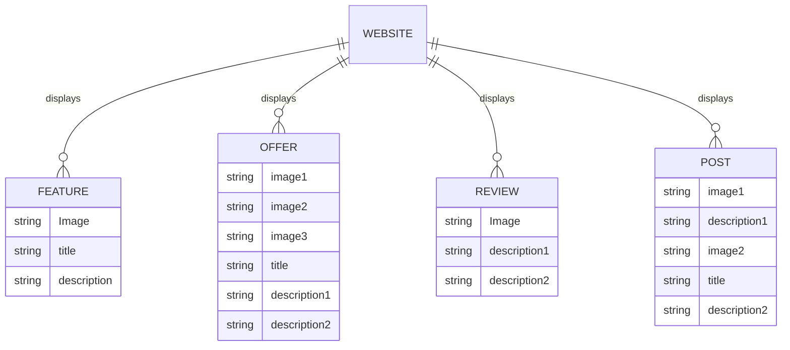

# Database Design

This document describes the data schema inferred from the JavaScript data structures used for rendering the website.

## Entity-Relationship Diagram

As there is no physical database, the following ER diagram represents the logical entities and their attributes as defined in `render.js`.

## Data Definitions

### Feature (Why Choose Us)
- `Image`: Path to the feature icon.
- `title`: Short title of the feature.
- `description`: Detailed explanation of the feature.

### Special Offer
- `image1`: Main accommodation image.
- `image2`: Rating icon image.
- `image3`: Favorite/Heart icon image.
- `title`: Name of the accommodation.
- `description1`: Dates of the offer.
- `description2`: Price and duration details.

### Review
- `Image`: Customer avatar image.
- `description1`: Review testimonial text.
- `description2`: Author name and role.

### Post (Recent Posts)
- `image1`: Featured post image.
- `description1`: Date of the post.
- `image2`: Reading time icon.
- `title`: Post title.
- `description2`: Post excerpt.
