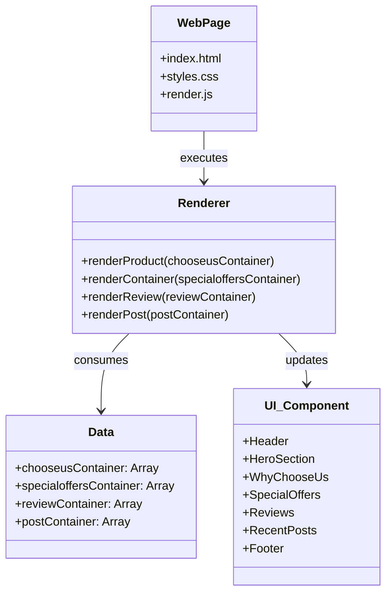
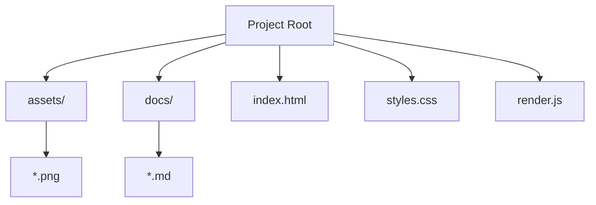

# Structural Diagrams

This document contains structural diagrams showing the relationship between the main components of the Hotel Website.

## Class Diagram

While the project is implemented using procedural JavaScript, the following diagram represents the logical structure of the UI components and their rendering logic.

## Package Diagram

